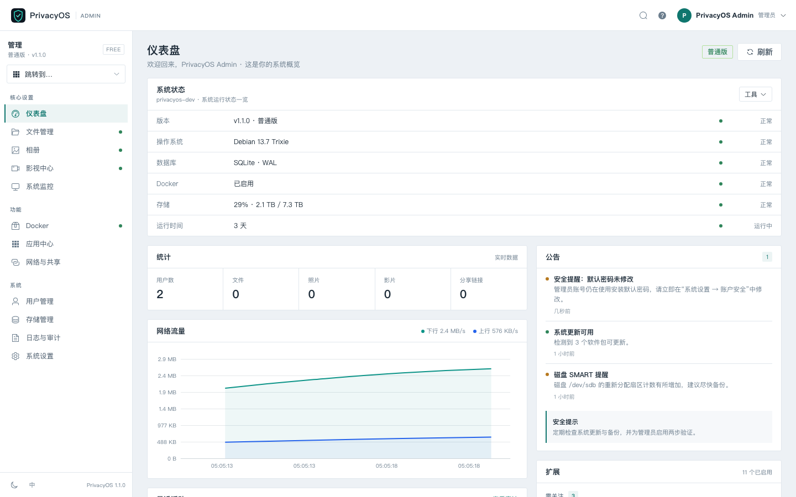
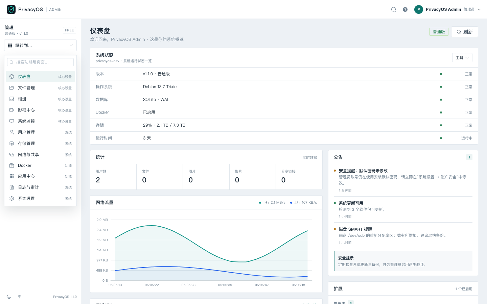
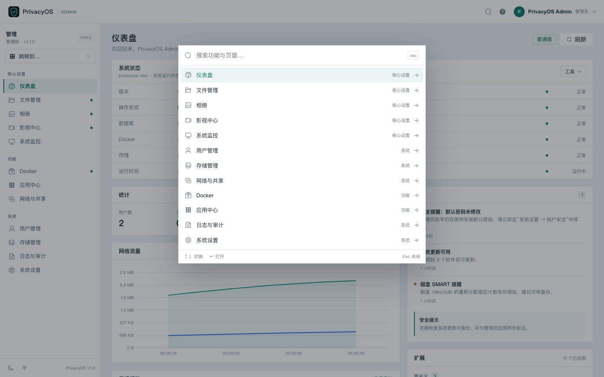
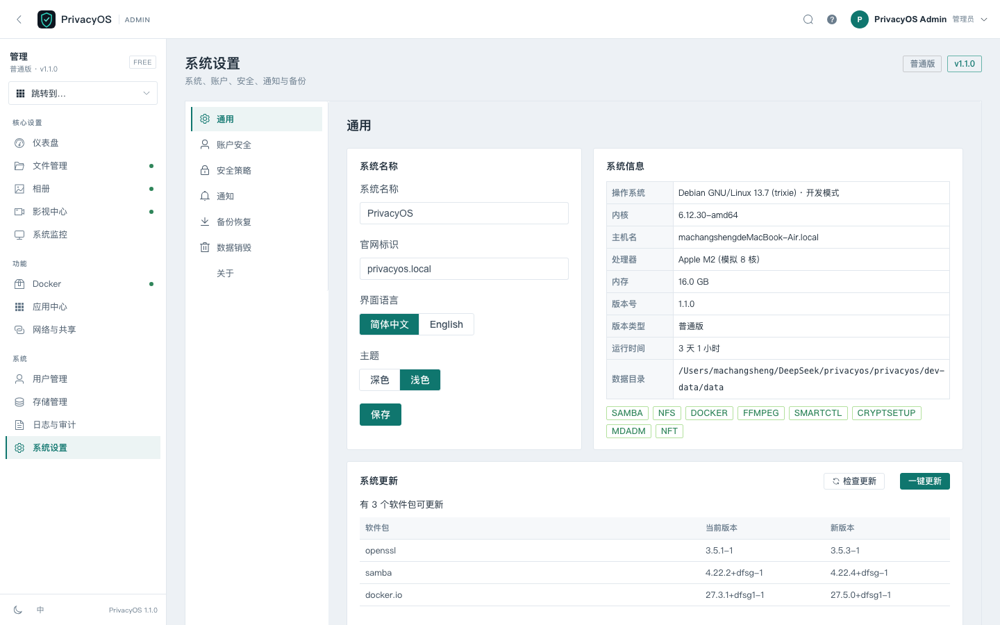
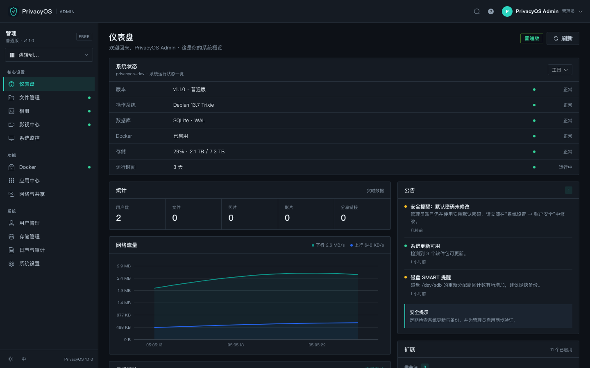
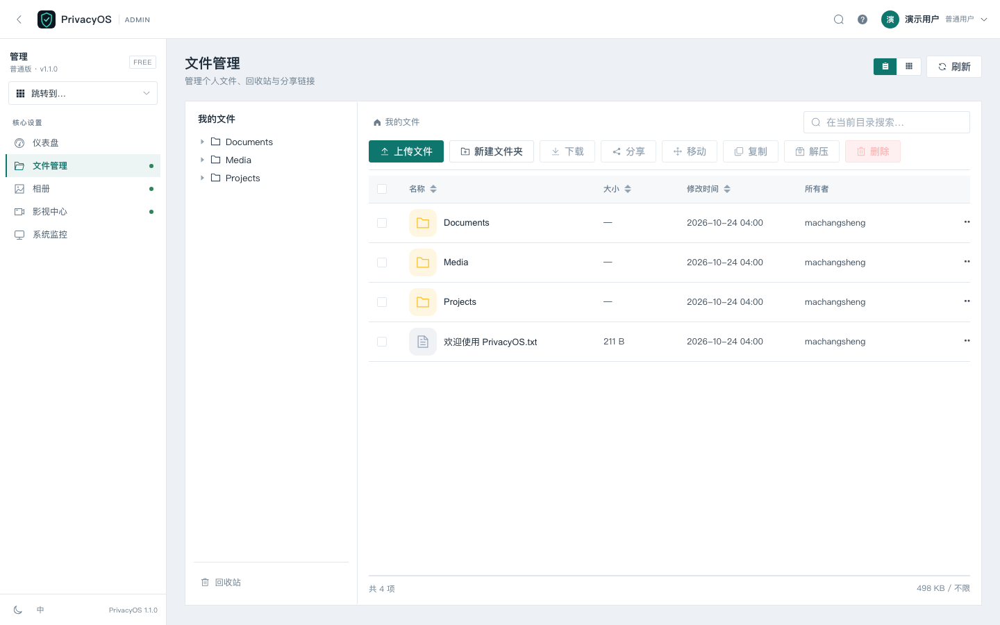
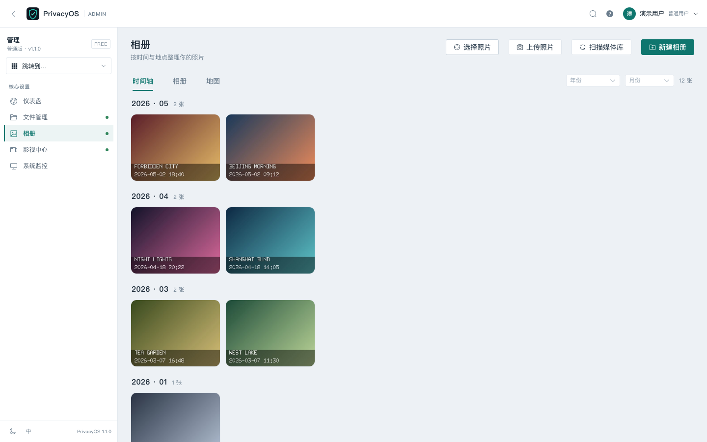
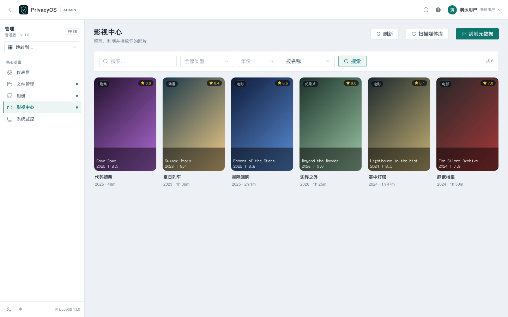
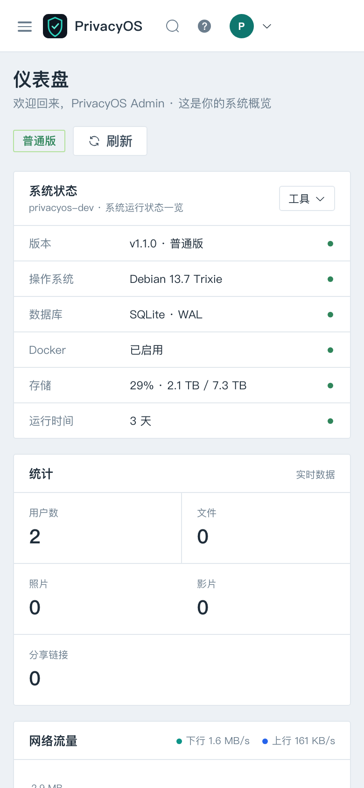
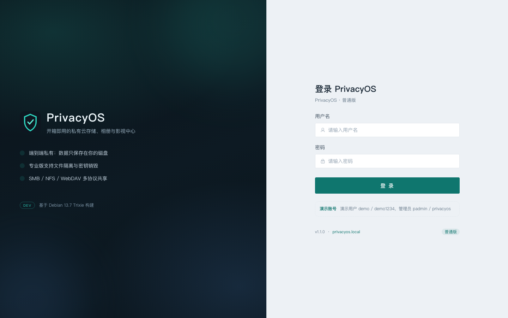

# PrivacyOS

**隐私优先的个人 NAS 系统** —— 基于 Debian 13.7 Trixie 构建，浏览器即可完成文件、相册、影视、容器、存储与用户管理。

PrivacyOS 不是"又一个网盘界面"，而是一套**可安装的操作系统 + 管理面板**：安装器基于 Debian Installer（preseed），面板后端是静态编译的 Go 服务，前端是 Vue 3 + Element Plus。普通版强调易用与共享，专业版强调**用户间强制隔离**与**数据销毁**。



**Flarum 2.0 Admin 风格**：固定顶栏 + 白色侧边导航 + 浅灰内容画布 + 扁平 Widget 卡片。
区域之间用颜色和 1px 边框区分，不使用悬浮阴影或大圆角岛屿。导航按「核心设置 / 功能 / 系统」
分组，侧栏顶部的「跳转到…」可搜索全部模块；`⌘/Ctrl + K` 打开命令面板。

| 可搜索导航下拉 | 命令面板 |
| --- | --- |
|  |  |

| 系统设置（侧栏白色 / 功能区灰色） | 深色主题 |
| --- | --- |
|  |  |

| 文件管理 | 相册（演示数据） |
| --- | --- |
|  |  |

| 影视中心（演示数据） | 移动端布局 |
| --- | --- |
|  |  |

登录页：



## 功能一览

| 模块 | 能力 |
| --- | --- |
| 管理界面 | 固定顶栏、侧边导航、可搜索下拉、命令面板、Widget 仪表盘、浅色/深色主题、移动端抽屉 |
| 文件管理 | 目录树、上传/下载、新建/重命名/移动/复制、压缩/解压、回收站、配额、分享链接、WebDAV |
| 相册 | EXIF 自动归档 `年/月/日`、时间轴、缩略图、GPS 坐标视图、相册分类、批量操作、分享 |
| 影视中心 | 媒体库扫描、ffprobe 元数据、TMDB 刮削、海报墙、详情、Range 流式播放、外挂字幕、倍速 |
| Docker | 容器启停/日志/资源占用、镜像拉取、Compose 项目部署与日志 |
| 存储管理 | 磁盘/SMART 健康、mdadm RAID 池创建/挂载/扩容、挂载点用量 |
| 网络与共享 | 网卡 DHCP/静态 IP、SMB/NFS 导出、端口占用、DDNS、DNS、nftables 防火墙（带自动回滚） |
| 应用中心 | qBittorrent / Jellyfin / Nextcloud / AdGuard Home / Alist / Syncthing / Uptime Kuma 一键部署 |
| 系统监控 | SSE 实时 CPU/内存/网络/磁盘 IO、进程管理、温度、运行时间 |
| 日志审计 | 登录/操作/系统/销毁日志、筛选、CSV 导出、90 天保留 |
| 系统设置 | 系统信息、更新、2FA、登录失败策略、HTTPS 自签名、通知（邮件/Telegram/Bark/Server酱）、备份恢复 |
| 专业版专属 | 每用户 LUKS 加密卷、密钥销毁、自动销毁策略、30 天删除冷静期、配额不可见 |

### 普通版 vs 专业版

| 能力 | 普通版 | 专业版 |
| --- | --- | --- |
| 管理员查看其他用户文件 | ✅（可关闭） | ❌ 强制隔离 |
| 用户之间文件隔离 | ❌ | ✅ Linux 权限 + 0770/0700 |
| 安装时全盘加密 | 可选 | ✅ LUKS2 + LVM |
| 密码错误递增延迟 / 锁定 | ✅ | ✅ |
| 密码错误触发数据销毁 | ❌ | ✅ LUKS 密钥销毁 / 覆写 / 删除 |
| 用户删除冷静期 | 立即删除 | ✅ 默认 30 天，可恢复 |
| 审计日志 | 基础 | 完整（含销毁事件） |

## 架构

```
浏览器 / SMB / NFS / WebDAV
            │
   ┌────────▼─────────┐
   │  Vue 3 Web 面板   │  Element Plus · ECharts · Pinia · i18n
   └────────┬─────────┘
            │ REST /api/v1 + SSE
   ┌────────▼─────────┐
   │  privacyos-server │  Go 1.24 · Gin · SQLite(WAL) · 单体静态二进制
   │  auth / files /   │
   │  photos / movies  │
   │  docker / storage │
   │  policy engine    │
   └────────┬─────────┘
            │
 ┌──────────▼──────────────────────────────────────┐
 │ Debian 13.7：systemd · Samba · NFS · Docker      │
 │ mdadm · SMART · LUKS2 · nftables · ffmpeg        │
 └─────────────────────────────────────────────────┘
```

- 后端在**无 CGO** 模式下交叉编译为 `linux/amd64` 单文件，运行时不依赖 Go/Python。
- 数据库为 SQLite（WAL），随配置目录一起备份。
- 所有硬件相关操作（磁盘、Docker、systemd）在开发模式下由模拟实现替代，便于在 macOS/Windows 上开发。

## 快速开始（开发模式）

前置：Go 1.24+、Node.js 20+。

```bash
# 方式一：前后端热更新开发
make dev

# 方式二：后台运行完整管理界面（单端口，适合直接体验）
make demo
```

- 管理界面：<http://127.0.0.1:8080>（`make demo`）或 <http://127.0.0.1:5173>（`make dev`）
- API：<http://127.0.0.1:8080/api/v1>
- 后台停止：`make demo-stop`，日志在 `runtime/privacyos.log`
- 管理员：`padmin / privacyos`
- 演示用户：`demo / demo1234`（含示例照片、影片、文件）
- 数据写入 `dev-data/`，使用模拟磁盘/容器/监控数据，不触碰真实系统。

也可以分别启动：

```bash
cd backend && PRIVACYOS_DEV=1 go run ./cmd/privacyos-server
cd frontend && npm install && npm run dev
```

## 构建安装 ISO

> ⚠️ ISO 必须在 **Linux** 上构建（需要 `xorriso` 生成 BIOS+UEFI 混合引导）。
> macOS 请使用 Docker 构建脚本或 CI。

```bash
# 1) 构建后端 + 前端 + 安装载荷（Linux 二进制）
make payload

# 2) 重新打包 Debian 13.7 DVD 为 PrivacyOS ISO
make iso ISO_SOURCE="/path/to/debian-13.7.0-amd64-DVD-1.iso"

# 3) 校验
make verify
```

或在 macOS 上：

```bash
./installer/scripts/build-payload.sh
./installer/scripts/build-in-docker.sh \
  --source "/path/to/debian-13.7.0-amd64-DVD-1.iso"
```

产物：

```
build/privacyos-1.1.0-amd64.iso
build/privacyos-1.1.0-amd64.iso.sha256
build/payload/                     # 安装载荷
build/LUKS-PASSPHRASE.txt          # 专业版安装时的 LUKS 口令（务必保存）
build/initial-admin-password       # 首次安装的管理员密码
```

写入 U 盘后从 U 盘启动，选择 **Normal edition** 或 **Pro edition (full disk encryption)**。
安装完成后访问 `http://<设备IP>`，初始密码见目标机 `/root/privacyos-initial-password`。

> 提供的 `debian-13.7.0-amd64-DVD-1.iso` 不包含 Samba 服务端 / NFS 服务端 / Docker 包。
> 安装器会先完成离线核心安装；首次联网启动时 `privacyos-provision` 自动从
> `deb.debian.org` 补齐这些组件，离线环境下面板会标记组件不可用并自动降级。

详细步骤见 [安装与 ISO 构建](docs/installation.md)。

## 目录结构

```
privacyos/
├── backend/                 Go 后端（cmd + internal/{api,auth,core,files,...}）
├── frontend/                Vue 3 前端（views/layouts/components/api/locales）
├── installer/
│   ├── preseed/             common / normal / pro preseed
│   ├── boot/                isolinux 与 GRUB 启动菜单
│   ├── payload/             install.sh、banner、systemd、smb.conf、provision
│   ├── scripts/             build-payload.sh / build-iso.sh / verify-iso.sh / docker
│   └── Dockerfile.builder
├── docs/                    架构、API、数据库、安装、用户手册、安全、开发
├── scripts/dev.sh           开发环境启动脚本
├── deploy/                  预留的部署扩展目录
├── docker-compose.dev.yml
├── Makefile
└── VERSION
```

## 文档

- [架构设计](docs/architecture.md)
- [REST API](docs/api.md)
- [数据库结构](docs/database.md)
- [安装与 ISO 构建](docs/installation.md)
- [用户手册](docs/user-guide.md)
- [安全模型](docs/security.md)
- [开发指南](docs/development.md)

## 安全设计要点

- 密码使用 bcrypt（cost 12）；会话为短期 JWT + 服务端可撤销 Session。
- 登录失败指数退避（3s → 6s → … 上限 300s），达到阈值临时锁定。
- 专业版可配置"密码错误 N 次 → 销毁该用户数据"，默认使用 LUKS 密钥销毁，
  销毁后数据不可恢复；未启用加密卷时按策略回退到覆写或删除。
- 用户文件路径全部经过沙箱解析（拒绝 `..`、绝对路径、符号链接逃逸）。
- 面板默认仅 HTTP；建议在系统设置中生成证书启用 HTTPS，并启用 2FA。
- 安装器默认关闭 root SSH 登录、开启内核加固与审计。

完整威胁模型与限制见 [安全模型](docs/security.md)。

## 已知限制

- 相册人脸识别、影视实时转码、地图底图尚未实现（地图视图使用坐标散点）。
- 专业版"全盘加密"依赖安装时的 LUKS 口令；自动化安装使用构建时生成的随机口令，
  请务必在构建机上保存 `build/LUKS-PASSPHRASE.txt` 并尽快更换。
- 提供的 DVD-1 不含 Samba/NFS/Docker 服务端，离线安装时相关功能自动降级。
- 未在真实 Debian 硬件上执行完整安装（当前开发环境为 macOS）；ISO 构建脚本需在 Linux 验证。
- 单机 SQLite 架构适合家庭/小型团队，超大规模并发需迁移 PostgreSQL 与独立媒体服务。

## 许可证

MIT License，详见 [LICENSE](LICENSE)。
